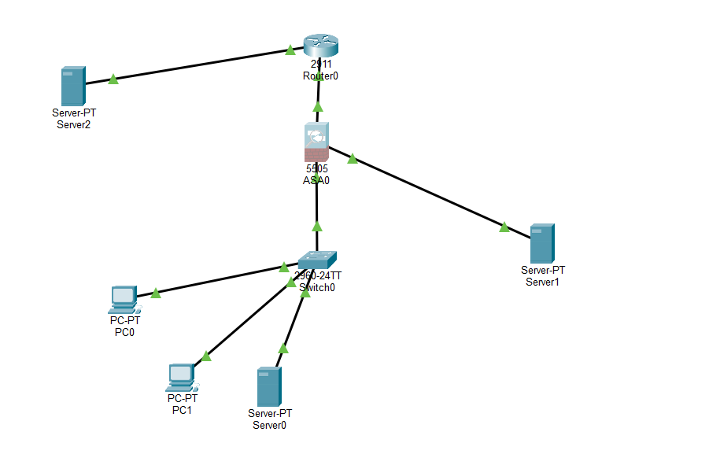
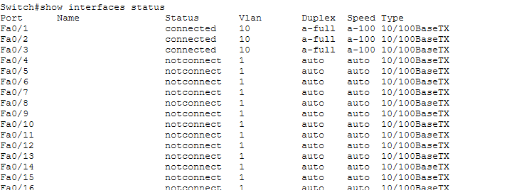
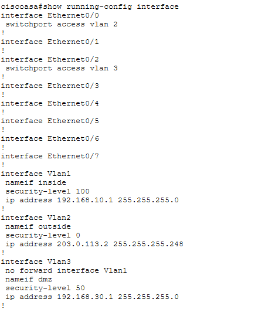
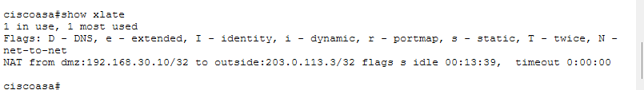
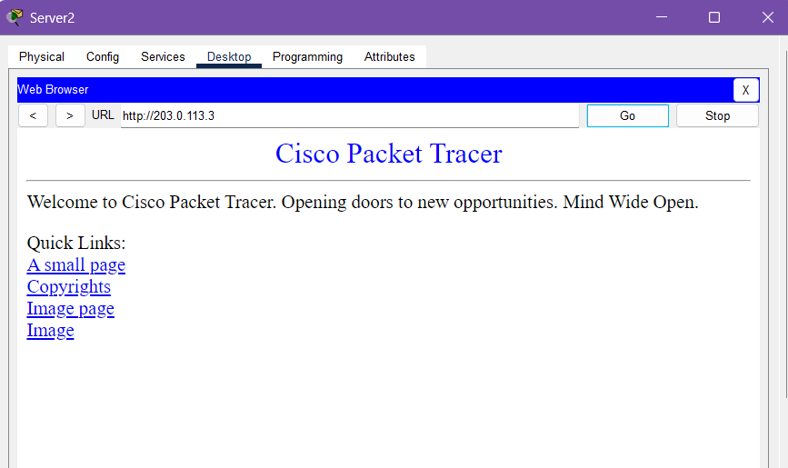

# Enterprise Network Security — Cisco Packet Tracer

A simulated enterprise network built with Cisco Packet Tracer. The project demonstrates network segmentation, routing, firewall zones, DHCP, DNS, NAT/PAT, DMZ publishing, and basic security validation using a Cisco ASA 5505.

> **Lab disclaimer:** This is a Packet Tracer learning project, not a production-ready network. Packet Tracer simulates a subset of Cisco ASA features; behaviour in this lab may differ from a physical ASA or a current enterprise firewall.

## Project objectives

- Build an enterprise-style network with separate Inside, Outside, and DMZ security zones.
- Segment the employee LAN with a switch VLAN.
- Configure router and firewall interfaces, IP addressing, and routing.
- Provide DHCP to employee workstations and DNS for the internal lab.
- Allow employee Internet access using Dynamic PAT.
- Publish a DMZ web server through Static NAT and restrict inbound access with an ACL.
- Validate permitted and denied traffic in Packet Tracer.

## Network topology

The lab uses a Cisco 2911 router, Cisco ASA 5505 firewall, Cisco 2960 switch, two employee PCs, an internal DNS server, a DMZ web server, and a simulated external server.

### High-level traffic paths

- **Employee to Internet:** PC → 2960 switch → ASA Inside → ASA Outside (PAT) → router → InternetServer.
- **Employee to internal website:** PC → switch → ASA → DMZ web server using its private address.
- **External visitor to public website:** InternetServer → router → ASA Outside (ACL and Static NAT) → DMZ web server.

## Devices and roles

| Device | Role |
|---|---|
| Cisco 2911 router | Connects the ASA to the simulated external network |
| Cisco ASA 5505 | Firewall, security-zone gateway, DHCP service, and NAT/PAT |
| Cisco 2960 switch | Connects employee PCs and the internal DNS server |
| PC0 and PC1 | Employee workstations; DHCP clients |
| Server0 | Internal DNS server; static IP |
| Server1 | Public-facing HTTP server in the DMZ; static IP |
| Server2 | Simulated external/Internet host used for testing |

## Addressing plan

| Network / zone | Subnet | Gateway or interface |
|---|---|---|
| Inside | `192.168.10.0/24` | ASA Inside: `192.168.10.1` |
| DMZ | `192.168.30.0/24` | ASA DMZ: `192.168.30.1` |
| Outside link | `203.0.113.0/29` | ASA: `203.0.113.2`; router: `203.0.113.1` |
| Simulated Internet | `198.51.100.0/24` | Router: `198.51.100.1` |

### Host addresses

| Host | Address | Addressing |
|---|---|---|
| PC0 | DHCP from `192.168.10.100–192.168.10.131` | Dynamic |
| PC1 | DHCP from `192.168.10.100–192.168.10.131` | Dynamic |
| Server0 (DNS) | `192.168.10.12/24` | Static |
| Server1 (DMZ web) | `192.168.30.10/24` | Static |
| Server2 (external test host) | `198.51.100.10/24` | Static |

All Inside hosts use `192.168.10.1` as their default gateway. Server1 uses `192.168.30.1`; Server2 uses `198.51.100.1`.

## VLAN and firewall-zone design

The 2960 switch uses VLAN 10 for the employee LAN:

| Switch port | Connected device | VLAN |
|---|---|---:|
| Fa0/1 | PC0 | 10 |
| Fa0/2 | PC1 | 10 |
| Fa0/3 | Server0 (DNS) | 10 |
| Gi0/1 | ASA Inside connection (Ethernet0/1) | 10 |

The ASA 5505 uses its own local VLAN identifiers:

| ASA interface | ASA VLAN | Security name | IP address | Security level |
|---|---:|---|---|---:|
| Ethernet0/1 / Vlan1 | 1 | Inside | `192.168.10.1/24` | 100 |
| Ethernet0/0 / Vlan2 | 2 | Outside | `203.0.113.2/29` | 0 |
| Ethernet0/2 / Vlan3 | 3 | DMZ | `192.168.30.1/24` | 50 |

The switch uses VLAN 10 while the ASA uses VLAN 1 for the Inside side. The switch-to-ASA connection is an access link carrying untagged Ethernet frames, so the VLAN IDs do not need to be identical on the two devices.

The public web server is connected directly to ASA Ethernet0/2 in the DMZ.

### ASA 5505 Base License note

This lab uses the ASA 5505 Base License's three-VLAN arrangement. The DMZ interface includes `no forward interface Vlan1`, restricting forwarding initiated from the DMZ toward the Inside interface. This is a platform/license-specific lab constraint.

## Services and firewall configuration

### DHCP

The ASA provides DHCP to clients on the Inside interface:

- Pool: `192.168.10.100–192.168.10.131`
- Default gateway: `192.168.10.1`
- DNS server option: `192.168.10.12`
- Lease duration: 86,400 seconds (24 hours)

PC0 and PC1 are DHCP clients. Server0 and Server1 use static addresses so that their service addresses remain predictable.

### DNS and HTTP

- Server0 provides DNS for the lab.
- The internal A record `www.mycompany.com` resolves to `192.168.30.10`.
- Server1 hosts the HTTP website in the DMZ on TCP port 80.
- Employees access the web server using its private DMZ address through the internal DNS record.

### Routing

- The ASA has a default route via `203.0.113.1`.
- The router has a host route for the public web-server mapping `203.0.113.3/32` via the ASA at `203.0.113.2`.
- The router also has a route to the Inside subnet via the ASA for the lab's external-to-Inside security tests.

### NAT

| Purpose | NAT type | Mapping |
|---|---|---|
| Employee Internet access | Dynamic PAT | Inside subnet translated using the ASA Outside interface address (`203.0.113.2`) |
| External access to DMZ web server | Static NAT | `203.0.113.3` ↔ `192.168.30.10` |

The Static NAT mapping is for the full server IP. The inbound ACL limits permitted external access to HTTP (TCP port 80); the NAT mapping itself is not port-specific.

### Inbound ACL

The ASA Outside ACL permits TCP port 80 to the DMZ web server's real address (`192.168.30.10`). Other unsolicited traffic from the lower-security Outside zone toward higher-security zones is not permitted by the lab policy.

## Security validation

The following tests were performed in Packet Tracer:

| Test | Expected behaviour | Result |
|---|---|---|
| Employee → internal DNS server | Allow | Passed |
| Employee → DMZ website using private IP | Allow | Passed |
| Employee → simulated Internet server | Allow | Passed |
| External host → public DMZ website address (`203.0.113.3`) | Allow HTTP | Passed |
| External host → employee network | Block | Passed |
| DMZ server → employee network | Block | Passed |
| External host → internal server | Block | Passed |

Packet Tracer Simulation Mode was used to inspect packet flow and firewall drops. The external HTTP test showed the ASA translating the destination from `203.0.113.3` to `192.168.30.10` and the web server generating a response.

### Addressing behaviour to note

- Internal employees use the private DMZ address (`192.168.30.10`) for the website.
- External users use the public mapped address (`203.0.113.3`).
- Hairpin/U-turn NAT is not configured, so internal users should not use the public mapped address to reach the same server.
- The lab's DNS record is an internal record; public DNS hosting is outside this simulation's scope.

## Repository contents

- [Packet Tracer project](packet-tracer/Enterprise-Network.pkt)
- [Router configuration](Configurations/router-config.txt)
- [Switch configuration](Configurations/switch-config.txt)
- [ASA firewall configuration and verification output](Configurations/firewall.txt)
- [IP addressing plan](Documentation/ip-addressing.txt)
- [Security test results](Documentation/test-results.txt)
- [Screenshots](Screenshots/)

### Selected evidence

**Topology**

**VLAN configuration**

**Firewall interfaces and zones**

**NAT and DMZ publishing**

**External access to the DMZ website**

## How to open the lab

1. Download `packet-tracer/Enterprise-Network.pkt`.
2. Open Cisco Packet Tracer.
3. Select **File → Open** and choose the downloaded `.pkt` file.
4. Use Realtime mode for normal connectivity tests or Simulation mode to inspect packet flow.

## Limitations and future improvements

- The project is a Packet Tracer simulation using an ASA 5505 Base License; some commands and behaviours differ from physical ASA hardware and modern firewall platforms.
- The external web service is demonstrated over HTTP for this lab; HTTPS and certificate management are not implemented.
- The internal DNS record is configured for the lab. Public DNS hosting and production domain delegation are not implemented.
- This lab does not represent a production security review or penetration test.
- A future extension could recreate the design with pfSense/OPNsense, Linux and Windows virtual machines, then add traffic monitoring and IDS/IPS.

## Learning outcomes

This project provided hands-on practice with:

- VLANs, access ports, subnetting, and IP addressing
- Router interfaces, static routes, and default routing
- Cisco ASA security zones and security levels
- DHCP scopes and DNS A records
- Dynamic PAT and Static NAT
- Inbound ACLs and DMZ isolation
- Packet Tracer Simulation Mode and connectivity troubleshooting
